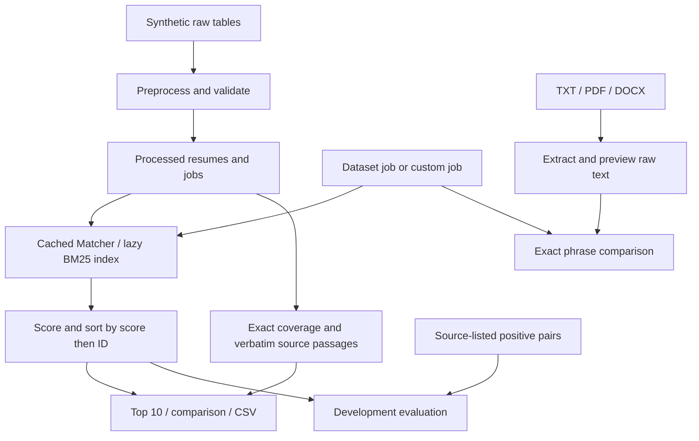

# TalentRAG — Evidence-Based Resume Matching

TalentRAG helps a reviewer search candidate profiles for a job and inspect the source text behind skill mentions. It is an interim student demonstration for ML beginners, evaluators and recruiters exploring transparent search. It addresses the difficulty of comparing many resumes consistently while retaining understandable reasons for a ranking.

**Current scope: ingestion, lexical retrieval, ranking and evidence display.** There is no LLM generation, model training, calibrated hiring probability or automated hiring decision. This is the retrieval/matching stage of the planned RAG system. No paid service or API key is needed. Initial installation/data download requires internet; ordinary matching is local.

## Quick orientation

1. Install Python 3.12 in a fresh environment and install `requirements.txt`.
2. Download the three data tables and preprocess them using [data/README.md](data/README.md).
3. Run the checks, then launch Streamlit.
4. Follow [TEAM_DEMO.md](TEAM_DEMO.md) for the team presentation.

The project owner confirmed the frontend runs outside the agent sandbox with:

```sh
python -m streamlit run app.py --server.address 127.0.0.1 --server.port 8502
```

Open **http://127.0.0.1:8502**. That is an owner-reported live launch, not an agent-performed browser test. Do not stop a working server just to repeat setup.

## Exactly what exists

| Capability | Current implementation |
| --- | --- |
| Interface | Three tabs: Match Candidates, Data & Evaluation, Project Status |
| Job input | Dataset title plus ID; description/skills shown; custom description and manually edited comma-separated skills |
| Ranking | Full 10,000-profile collection; Skill-only or BM25; deterministic ID ties |
| Results | Top 10, expandable details, required/preferred coverage, original source passages |
| Comparison/export | Two selected top-10 candidates; full ranked CSV with rank, ID, role, score, method and job ID |
| Resume uploads | UTF-8 TXT, text PDF via pypdf, DOCX via ZIP/XML; preview then exact raw-text comparison |
| Demo inputs | Two visibly fictional TXT files, separate from source dataset |
| Evaluation | Fixed 20-job development command, per-job CSV, metadata JSON |
| Semantic/hybrid search | Unavailable; no sentence model or fusion implementation |
| Reranking/generation/skill graph | Future work; no cross-encoder, LLM or graph is running |
| Scanned documents | No OCR; empty extraction reports an error |
| Windows verification | Not performed; portable package-based code and commands supplied |

The working UI is preserved. Its static Project Status sentence still mentions the earlier PDFKit fallback; **the current backend uses pypdf only**. The evaluation tab's command contains the original Mac interpreter path; teammates should use `python evaluate_demo.py` in their environment. These are historical text limitations, not active platform dependencies.

## Architecture



Labels enter evaluation only, never the Matcher. Streamlit caches the processed frames and Matcher using `st.cache_resource`, keyed by processed-file modification times. BM25 builds on its first request and reuses an in-memory index. There is no database, embedding cache or background model training. Changing a job/method hides stale ranking results until reranking.

## Data source, counts and relationships

Reference source: [michaelozon/candidate-matching-synthetic](https://huggingface.co/datasets/michaelozon/candidate-matching-synthetic). Its [dataset card](https://huggingface.co/datasets/michaelozon/candidate-matching-synthetic/blob/main/README.md) describes synthetic profiles and declares MIT. The local schemas/counts match this reference, but the original local download URL/revision was not recorded. Exact upstream byte provenance has not been independently established; local SHA-256 values are in `data/README.md`.

Dataset binaries are **excluded from public Git**. The card declares MIT, but a complete standalone copyright/license notice was not retrieved during handoff. Download directly using the documented steps and retain upstream terms. Do not apply the dataset license to project code automatically; this handoff does not select a new project-code license. Existing local data is preserved.

| Local table | Actual rows | Relationship/purpose |
| --- | ---: | --- |
| Raw resumes | 10,000 | Unique `resume_id` |
| Raw jobs | 2,500 | Unique `job_id` |
| Raw matches | 2,500 | One job with a list of positive resume IDs |
| Processed resumes | 10,000 | Cleaned structured profiles |
| Processed jobs | 2,500 | Cleaned job fields/skill lists |
| Processed match_pairs.csv | 75,000 | One `(job_id, resume_id)` per row |

Each local job has 30 distinct listed positives. Jobs connect to many resumes through the pair table; resumes may occur for multiple jobs. Resume fields include role, seniority, years of experience, industry, education, skills, summary and experience bullets. Job fields include title, seniority, industry, description, required/preferred skills, responsibilities and requirements.

These synthetic records are not verified real applicant histories. Generic experience bullets are common. Source-generated positive lists provide incomplete supervision: **unlisted candidates are unlabeled, not verified mismatches**. The source's use of “ground truth” does not establish independent human hiring judgments.

## Preprocessing, validation and feature extraction

The original `preprocess_data.py` reads raw parquet files; collapses whitespace in selected descriptive fields; cleans skill strings; removes case-insensitive duplicates while preserving first spelling/order; explodes `relevant_resume_ids`; and writes two processed parquet files plus pair CSV. It does not rewrite experience bullets or job responsibilities/requirements arrays. No embeddings or learned features are created.

`audit_data.py` checks missing values, repeated IDs, duplicate pairs and unknown links. `verify_processed.py` joins the first job's source positives to resumes. Runtime loading checks required columns, nonempty tables, null/duplicate primary IDs, label columns and ID alignment. This is not exhaustive validation of every malformed field value.

Runtime features are normalized skill sets and BM25 token counts/document lengths. Normalization casefolds and collapses whitespace. Education, industry and years are displayed as context, not app ranking weights. BM25 sees role, summary, skills and experience, rather than all profile metadata.

## Skill-only ranking

Let `R` be normalized required skills and `S` candidate skill-list entries. Score = `len(R & S)`. Sort descending by score, then ascending resume ID. Preferred skills are displayed but do not affect this app method. A required skill is needed; a description-only job can use BM25.

Numerical example (illustrative, not evaluation records): required Python, SQL, Flask; preferred Docker.

| Candidate list | Required matches | Score | Preferred coverage |
| --- | --- | ---: | --- |
| Python, SQL, Flask | Python, SQL, Flask | 3 | 0/1 |
| Python, SQL, Docker | Python, SQL | 2 | 1/1 |
| Python | Python | 1 | 0/1 |

Two candidates scoring 3 are ordered by ID. No app seniority tie preference is applied. Skill-list matching compares complete normalized entries, not arbitrary substrings or semantic equivalents.

## BM25: simple explanation and exact implementation

BM25 is lexical search. Query words appearing in a document earn relevance credit. Rare terms usually tell us more than ubiquitous terms. Repetition gives diminishing returns, and document-length normalization prevents long resumes from winning just because they contain more words. It neither infers synonyms nor verifies claims.

With installed requirements, the engine is **rank-bm25 0.2.2 / BM25Okapi**. The explicitly labelled local Okapi fallback remains if that package is absent; no semantic method is substituted. This handoff tested the actual package path. Index rows retain the reset candidate order, and the same IDs receive the computed scores. Shuffled-row ID alignment is tested.

Candidate document fields are built in this order:

```text
Role: <role>
Summary: <summary>
Skills list: <comma-separated structured skills>
Experience: <newline-separated experience bullets>
```

Query text contains the description, `Required skills:` plus its list, and `Preferred skills:` plus its list. Section labels are also tokenized. The separate job title, responsibilities and requirements arrays are not appended. There are no special field boosts; repeated query tokens contribute repeatedly.

Both sides are casefolded, whitespace-collapsed and tokenized with `r'[\w]+(?:[+#]+)?'`. This preserves `c++` and `c#`; dots/hyphens split tokens. There is no BM25 stemming, stop-word removal or synonym expansion.

Default parameters are `k1=1.5`, `b=0.75`, `epsilon=0.25`. Sum this contribution over query tokens:

```text
IDF(token) * tf * (k1 + 1)
--------------------------------------------
tf + k1 * (1 - b + b * document_length / average_length)
```

`tf` is that token's candidate-document count. The package uses `log(N - df + 0.5) - log(df + 0.5)` for IDF, replacing negative values with `epsilon * average_idf`. `N` is document count; `df` is the count containing the token. Unknown terms contribute zero. Sort descending score, ascending ID for ties. Scores are relevance units, not probabilities or bounded percentages.

## Original seniority/preferred experiments

The preserved `rank_dataset.py` has experiments distinct from the app's selectors:

1. Required-skill count, ID ties.
2. Required count, then exact seniority agreement, then ID.
3. `2 * required_matches + preferred_matches`, then required count, then ID. Required duplicates are removed from preferred.

Rerunning it during handoff gave **0.20 mean listed matches per top five for all three**, on the same 20 jobs. Seniority: 3 improved, 14 unchanged, 3 worsened. Preferred weighting: 1 improved, 18 unchanged, 1 worsened. Those methods did not improve the mean. The app does not silently incorporate their weights or seniority policy.

## Skill-list mentions versus experience evidence

Coverage compares exact normalized list entries, with required/preferred duplicates counted only as required. Missing mentions do not prove inability.

Relevant passages come only from summary and experience bullets. The selector uses boundary-aware normalized phrase mentions of requested skills. If skills are absent, description tokens are used with a small common-word exclusion list. Matching passages preserve original wording and show resume ID/source section. This is simple lexical passage selection, not semantic verification. If no experience bullet matches, the app says so; it never turns a skills-list mention into an experience quote.

## Upload behavior

| Format | Parser | Limitations |
| --- | --- | --- |
| TXT | UTF-8 / UTF-8 BOM decode | Other encodings fail clearly |
| PDF | `pypdf.PdfReader` and `extract_text()` per page | No OCR; imperfect column/reading order; encryption rejected |
| DOCX | Standard-library ZIP/XML of `word/document.xml` | Main paragraphs, including table paragraphs; no header/footer/drawing reconstruction |

`python-docx` is retained in requirements because it is installed in the environment, but the current parser does not call it. There is no macOS PDFKit/AppleScript dependency and no borrowing packages from base Conda.

Inputs over 10 MB and DOCX declared expanded content over 30 MB are rejected. Empty extraction reports possible scanned-PDF/OCR limitations. Malformed files fail clearly rather than receiving a misleading zero score. This is a local demo parser, not a hardened public upload service.

The app previews extracted text before **Compare extracted text**. Comparison checks exact boundary-aware phrases anywhere in raw text and quotes matching lines. It does not infer structured experience sections. Uploads remain separate from the candidate collection, in the Streamlit session; no explicit resume database/disk persistence is implemented.

## Evaluation: procedure, definitions, actual results

```sh
python evaluate_demo.py
```

All 10,000 candidates are ranked. Jobs exclude `J_000000`, then use `.sample(n=20, random_state=42)` on the existing row order. Each job is ranked by Skill-only and BM25. Labels are used only after ranking. CSV records 40 method/job rows with engine, job ID, candidate count, positive count, top-five IDs, metrics and seconds. JSON records sample IDs, seed, count, timestamp and definitions.

- **Listed-positive overlap@5:** count of top-five IDs also listed for that job, 0–5. This project's overlap is a count, not precision or Jaccard similarity.
- **Listed-positive recall@5:** overlap divided by distinct listed positives for the job (30 locally).
- Means are macro averages over the 20 jobs.

Recorded rerun using installed rank-bm25:

| Method | Mean overlap@5 | Mean listed-positive recall@5 |
| --- | ---: | ---: |
| Skill-only | 0.20 | 0.006667 |
| BM25 / rank-bm25 0.2.2 | 0.15 | 0.005000 |

The CSV engine column identifies the current run. These reproduce earlier fallback results, not an improvement. Seconds include lazy index creation on the first BM25 job and reflect one Mac; no portable speed claim is made. Use `python evaluate_demo.py --output results/my_run.csv` to preserve another run instead of replacing the default outputs.

This is a development sample already used for experiments, not a reviewed held-out test. Source positives are synthetic/incomplete. An unlisted candidate may be suitable; this measurement cannot estimate a verified mismatch rate or hiring accuracy. Scores have not been calibrated against hiring outcomes. **0.20 overlap is a mean count, not 20% accuracy.**

## macOS setup: fresh Python 3.12 environment

Install a Python 3.12 Conda distribution. From the cloned/downloaded project folder:

```sh
conda create -n talentrag-demo python=3.12 -y
conda activate talentrag-demo
python -m pip install --upgrade pip
python -m pip install -r requirements.txt
python -c "import sys; print(sys.executable); print(sys.version)"
python -c "import streamlit, pandas, pyarrow, numpy, rank_bm25, pypdf, docx; print('Imports OK')"
python -m pip check
```

Use a new environment name rather than changing the developer's original environment. Do not activate `.venv` on top of Conda. Download/preprocess with `data/README.md`, then run the checks below. A fresh network installation was not performed by the agent; installed-environment import checks were performed.

## Windows setup: Anaconda PowerShell Prompt

Install Miniconda/Anaconda for Windows. Download/extract the project ZIP, or use `git clone <PUBLIC_REPOSITORY_URL>` once an actual published URL is supplied. The placeholder is not a publication claim. Open **Anaconda PowerShell Prompt** and `cd` into the directory containing `app.py`.

```powershell
conda create -n talentrag-demo python=3.12 -y
conda activate talentrag-demo
python -m pip install --upgrade pip
python -m pip install -r requirements.txt
python -c "import sys; print(sys.executable); print(sys.version)"
python -c "import streamlit, pandas, pyarrow, numpy, rank_bm25, pypdf, docx; print('Imports OK')"
python -m pip check
```

Run the Windows download commands in `data/README.md`, then:

```powershell
python inspect_data.py
python audit_data.py
python preprocess_data.py
python verify_processed.py
python -m unittest discover -s tests -v
python tests/ui_smoke.py
python evaluate_demo.py
python -m streamlit run app.py --server.address 127.0.0.1 --server.port 8502
```

Open **http://127.0.0.1:8502** on that computer. Commands and PDF code are platform-independent, but **actual Windows execution has not been tested**. If activation fails in ordinary PowerShell, use the Anaconda prompt rather than changing system-wide policy. Initial downloads require internet.

## Launch and alternative ports

```sh
python -m streamlit run app.py --server.address 127.0.0.1 --server.port 8501
```

Open http://127.0.0.1:8501. If occupied, use `--server.port 8502` and http://127.0.0.1:8502 (or 8503). The wrapper `python launch_demo.py --server.port=8502` is another entry point using environment-local Streamlit. Do not kill someone else's server to free a port.

## Checks actually performed

- TalentRAG Python 3.12 import locations were all inside its environment: Streamlit 1.67.0, pandas 3.1.1, pyarrow 26.0.1, NumPy 2.5.4, rank-bm25 0.2.2, pypdf 7.0.1, python-docx 1.2.0. Requirements cover these installed direct dependencies; unrelated transitive packages are not all frozen.
- `python -m pip check`: no broken requirements.
- Seven backend tests passed: ID alignment/ties, missing files, empty/unsupported queries, boundaries/provenance, label-free ranking and TXT/DOCX/**pypdf** extraction including empty-PDF rejection.
- Expanded Streamlit AppTest passed: initial render, baseline/BM25, custom job, fictional upload, stale ranking hidden, missing metadata and invalid evaluation columns handled.
- Evaluation and the original seniority/preferred experiments reran with results above.
- Previous data audits found no missing raw values, duplicate IDs/pairs or broken references; rerun after downloading.
- No fresh-environment installation, Windows run or interactive agent browser test was performed. The owner separately confirmed live startup on 8502; the agent's earlier socket binding attempt was sandbox-blocked.

```sh
python -m unittest discover -s tests -v
python tests/ui_smoke.py
python -m pip check
python evaluate_demo.py
python rank_dataset.py
```

AppTest executes the actual app in Streamlit's testing runtime. It does not verify browser download behavior or a live HTTP server. `results/verification.txt` is a historical local record excluded from public Git; the UI says verification pending if it is absent.

## Folder guide

```text
app.py                    Three-tab UI (preserved)
launch_demo.py            Optional localhost launcher
talentrag/core.py         Data checks, normalization, ranking, passages
talentrag/uploads.py      Portable extraction and raw-text comparison
talentrag/runtime.py      Environment-local Streamlit import
evaluate_demo.py          Fixed development sample and CSV/JSON export
rank_dataset.py           Original baseline/seniority/preferred experiments
preprocess_data.py        Original cleaning and pair expansion
inspect_data.py           Original raw schema/count inspection
audit_data.py             Original null/duplicate/reference audit
verify_processed.py       Original pair/profile sample join
match_resume.py           Original tiny hard-coded toy example
tests/test_demo.py        Backend regression checks
tests/ui_smoke.py         Streamlit interaction checks
demo_resumes/             Two fictional TXT examples
data/README.md            Download, provenance and hashes
data/raw/                 Local raw parquet (not published)
data/processed/           Local generated tables (not published)
results/development.csv   Per-job recorded measurements
results/development.json Sample IDs, definitions, run metadata
requirements.txt         Direct dependencies, no model weights
TEAM_DEMO.md              Practical presentation guide
DEMO_GUIDE.md             Original longer demonstration reference
```

## Troubleshooting

| Problem | Action |
| --- | --- |
| Missing packages | Activate the intended environment, install requirements with `python -m pip`; use `python -m streamlit` rather than an unrelated executable |
| Conda/venv confusion | Check `python -c "import sys; print(sys.executable)"`; deactivate any venv, then activate Conda; never copy an environment directory |
| Base contamination | Remove manually added PYTHONPATH/site-packages overrides; inspect `python -c "import streamlit; print(streamlit.__file__)"`; current code does not append base paths |
| Missing processed files | Download all raw inputs into exact paths and run preprocessing |
| Download/schema changes | Check upstream Files page/revision and audits; do not invent replacement data or reuse metrics on changed data |
| Port conflict | Keep existing working app or choose 8502/8503 and match URL |
| Agent socket PermissionError | Run in normal Terminal/Anaconda Prompt outside sandbox |
| Scanned PDF / empty extraction | No OCR exists; use selectable text or provided TXT samples |
| Encrypted PDF | Supply an unlocked valid document; encryption is rejected |
| TXT decode failure | Save as UTF-8; legacy encodings are unsupported |
| Skill-only with no required list | Add at least one required skill or use BM25 with a nonempty description |
| Changed job has no ranking | Click Rank candidates again; stale results are hidden deliberately |
| Missing/corrupt results | Run `python evaluate_demo.py`; matching can run without saved evaluation artifacts |
| BM25 label differs from CSV | Install requirements and rerun evaluation; inspect actual engine field |
| Width deprecation warning | Existing UI passes AppTest; this warning is not a failed match |

## Five-minute demonstration

1. **0:00–0:45:** Show counts/tabs. In **Match Candidates**, keep **Dataset job**, choose a title/ID under **Select a job**, read the skill lists.
2. **0:45–1:30:** Select **Skill-only**, click **Rank candidates**; inspect **Top 10 candidates** and expand a resume. Explain coverage versus quoted evidence.
3. **1:30–2:15:** Switch to **BM25**, rerank, show engine label, use **Compare two candidates**, then **Export full ranked results (CSV)**.
4. **2:15–3:30:** Select **Custom job**; description “Build Python and SQL services using Flask”; required `Python, SQL, Flask`; preferred `Docker, Git`. Select `fictional_backend.txt` under **Or use a fictional demo TXT**, preview, click **Compare extracted text**. Switch to `fictional_analyst.txt` for missing phrases. The files can also be downloaded and uploaded through the uploader.
5. **3:30–4:30:** Open **Data & Evaluation**, explain actual overlap/recall and source-label limitations; inspect/download CSV/JSON.
6. **4:30–5:00:** Open **Project Status** and distinguish retrieval from unfinished generation/reranking. Refer to this README for current portable dependencies rather than the historical PDFKit sentence.

## Viva questions

1. **What problem is addressed?** Transparent candidate search with inspectable source text.
2. **Who is it for?** Students/evaluators and reviewers exploring search, not production automated hiring.
3. **What is RAG?** Retrieval-augmented generation combines retrieved sources with a generator. Only retrieval/matching is implemented here.
4. **Are these real resumes?** The source describes synthetic profiles; histories are not independently verified.
5. **How much data?** 10,000 resumes, 2,500 jobs and 75,000 expanded listed pairs.
6. **How does the baseline score?** Count complete normalized required skills in the candidate skills list.
7. **How are ties handled?** Ascending resume ID after descending score.
8. **Does preferred coverage affect Skill-only?** No. A separate original script experiments with weighting it.
9. **What does BM25 add?** Lexical retrieval using rarity, saturating repetition and length normalization.
10. **Does BM25 understand synonyms?** No; semantic retrieval is future work.
11. **What enters BM25?** Candidate role/summary/skills/experience; job description and required/preferred lists.
12. **Why show source sections?** To distinguish skill lists from actual summary/experience text without invented evidence.
13. **Does a quote prove expertise?** No, it is retrieved text from synthetic profiles.
14. **What if experience evidence is absent?** The app explicitly reports no relevant experience passage.
15. **How are uploads handled?** Preview extracted raw text, compare exact phrases, keep it separate from structured profiles.
16. **Can scanned PDFs work?** No OCR is implemented; empty extraction fails clearly.
17. **What is overlap@5?** Count of top-five IDs also present in the job's source-positive list.
18. **What is recall@5?** That count divided by the distinct listed positives, averaged per job.
19. **Are unlisted pairs negative?** No, they are unlabeled and may be relevant.
20. **Is 0.20 20% accuracy?** No. It is a mean overlap count, not hiring accuracy.
21. **Did BM25 improve results?** No: measured overlap was 0.15 versus 0.20 baseline; no improvement claim is justified.
22. **Are labels leaked into ranking?** Matcher receives candidate/job fields, not labels; measurement uses labels afterward. The development sample is still not held out.
23. **Was anything trained?** No learned model was trained; ranking uses exact rules and corpus statistics.
24. **What is next?** Semantic retrieval/fusion, reranking, grounded generation and independent review.
25. **Was Windows tested?** No. Portable code and commands are supplied; actual tests ran in the Mac TalentRAG environment.

## Roadmap and public handoff

Future: small pretrained semantic embeddings with ID-aligned caches; reciprocal rank fusion; cross-encoder reranking; grounded generation citing source sections; richer evidence dataset; skill graph; recruiter copilot; independently reviewed held-out evaluation. Semantic dependencies are neither required nor imported today; do not download a model to run this demo.

Git exclusions cover credentials, .env, environments, caches, weights, uploads, private documents and session logs. Fictional samples and synthetic evaluation artifacts are included. Publication requires a confirmed remote URL and commit/push outcome; this document alone does not assert publication.
